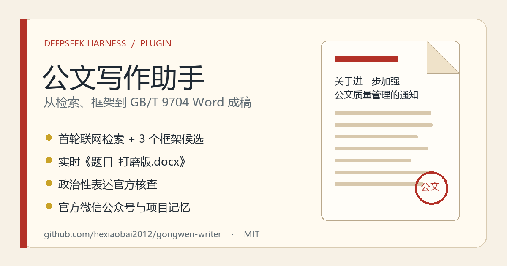

# 公文写作助手（gongwen-writer）

面向中文公文写作的 DeepSeek Harness 插件：从首轮检索、框架候选，到 GB/T 9704 Word 成稿、逐段逐句推敲、政治性表述核查和项目记忆，全部在本地工作区完成。



## 解决什么问题

公文写作不是“把话写长”，而是同时满足四件事：

1. **文种和结构正确**：通知、请示、报告、函、纪要、讲话各有自己的结构；
2. **格式正确**：页边距、字体、行距、页码、落款都要符合 GB/T 9704；
3. **政治性表述准确**：会议时间、届次、领导人职务、重要讲话、文件号不能凭记忆写；
4. **改稿过程可追踪**：每一次结构调整、段落和句子修改都要能回看、能恢复。

本插件把这四件事做成一条工作流，而不是只提供一个“生成公文”的按钮。

## 核心能力

### 1. 首轮检索 + 三个框架候选

新稿第一次出框架时，提示词要求先联网检索，再给 3 个结构不同的候选：

- 部署型：按任务板块推进；
- 问题型：按问题—原因—对策推进；
- 时间轴型：按阶段推进。

每个候选包含分节、每节任务、逻辑链、适用场景和风险。`gongwen_draft action=frames` 保存候选，`select_frame` 选定后才写正文。

### 2. 自包含 GB/T 9704 渲染

`python/render_docx.py` 使用 `python-docx` 直接生成 Word：

- A4，上 37mm、下 35mm、左 28mm、右 26mm；
- 全文固定行距 28 磅，段前段后为 0；
- 标题二号方正小标宋简体、不加粗、居中；
- 正文三号仿宋_GB2312，首行缩进 2 字符；
- 一级标题黑体、二级标题楷体_GB2312；
- 页码“- 1 -”四号仿宋，奇数页右下、偶数页左下；
- 落款首行右空 4 字符，日期和续行按首行中心对齐。

不依赖 `gongwen-skill`，也不需要手工调格式。

### 3. 实时打磨稿

每次 `create`、`replace`、`apply`、`insert`、`delete`、`move` 后，自动重写工作区根目录的：

```text
<标题>_打磨版.docx
```

同时维护固定预览文件：

```text
.gongwen-writer/preview/当前打磨稿.docx
```

侧边栏“打磨稿”按钮或 `present` 文件卡片打开一次后，后续修改自动刷新。

### 4. 政治性表述核查

- 扫描会议时间、会议名称/届次、领导人职务、重要讲话精神、重要指示、文件号、固定提法；
- 只采信政府机关官网及人民网、共产党员网、新华社等官方来源正文；
- 给出“已核实 / 冲突 / 未核实 / 需人工复核”；
- 默认只报告；`autoCorrect=true` 只自动替换有官方原句、可精确替换的日期和文件号；
- 核查报告写入项目 `factcheck.md` 和 `factcheck.json`；
- 导出前如未核查、核查后正文又修改、或仍有 P0 未决项，返回 `factcheckWarning`。

### 5. 官方微信公众号检索

- `gongwen_research action=search sources:["wechat"]` 发现 `mp.weixin.qq.com` 文章；
- `action=read` 用本地 Chrome 打开并核验公众号名称；
- 只有白名单官方账号可作为官方材料保存；
- 读取会请求 DSH 审批，完成后自动关闭 Chrome。

### 6. 项目记忆与推敲

- 项目记忆自动注入重心、受众/讲话人、结构、框架候选、已定事项、待办和最近改动；
- `gongwen_polish` 支持结构审、逐段、逐句、候选改法、采纳/放弃和历史回退；
- 每次修改记录 before/after、理由和时间。

## 工具

| 工具 | 用途 |
|---|---|
| `gongwen_draft` | guide / import / brief / create / frames / select_frame / get / update / set_outline / replace / insert / delete / move / render |
| `gongwen_polish` | start / structure / next / show / focus / propose / apply / discard / skip / finish / status / rewind / history |
| `gongwen_memory` | get / save / brief |
| `gongwen_research` | search / read / list / remove（含官方微信公众号） |
| `gongwen_factcheck` | scan / check / verify |
| `gongwen_browser` | open / close / status |
| `gongwen_export` | export / doctor |

## 安装

从 npm：

```bash
dsh plugin --profile <profile> add gongwen-writer
```

从源码：

```bash
git clone https://github.com/hexiaobai2012/gongwen-writer.git
dsh plugin --profile <profile> add ./gongwen-writer
```

要求：

- DeepSeek Harness，Node.js >= 22；
- Python 3.10+，并安装 `python-docx`；
- 可选：本机 Chrome，用于读取微信公众号或需要浏览器渲染的页面。

检查环境：

```text
gongwen_export action=doctor
```

## 数据与隐私

- 项目数据、预览、报告和参考材料都在工作区 `.gongwen-writer/`；
- 不内置 API Key，不主动上传公文；
- 浏览器和微信公众号读取需要用户审批；
- 检索只访问用户明确请求的官方来源；
- 使用云模型/云检索时，数据按 DSH 配置发送到对应服务商；
- 生成的 `.docx` 和 `.gongwen-writer/` 不应提交到公开仓库。

## 已知限制

- 当前实现 GB/T 9704 核心版式，不含红头版头、版记、桌签等特殊版式；
- PDF/扫描件尚未做 OCR；
- 事实核查是辅助工具，不能替代人工审签；
- 微信公众号可能触发验证页，需要重试或改用手机打开；
- 不同 DSH 版本的客户端 Slot 可能需要刷新页面后生效。

## 许可证

MIT，版权人 Alex。详见 [LICENSE](../LICENSE)。
